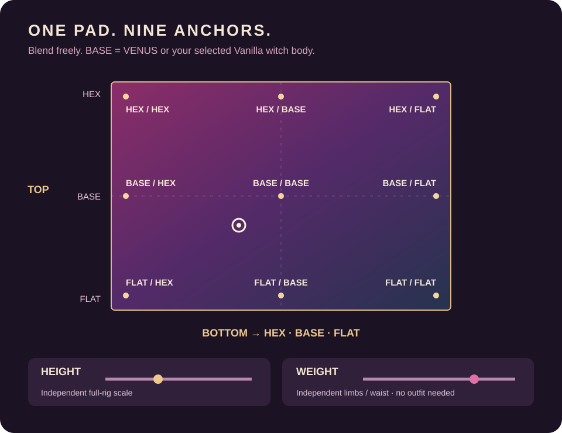
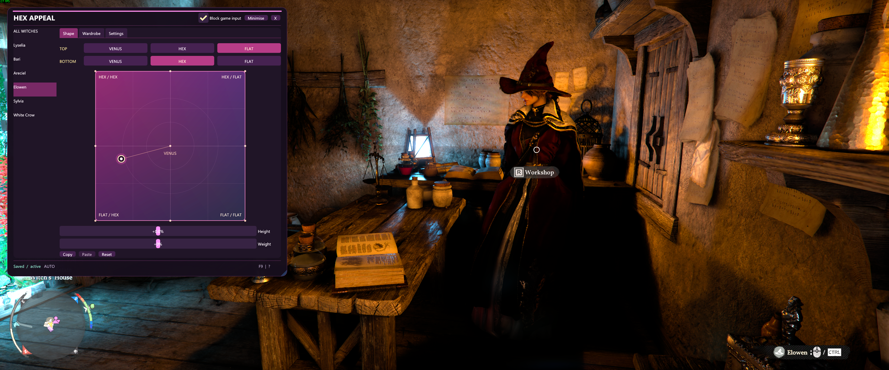

<b>VENUS. HEX. FLAT. Your questionable little blend of all three.</b>

  

Applies Venus Body for Damiane to every witch in Crimson Desert. Because even dark magic deserves better curves.

Choose **VENUS** for the witches or keep their original **Vanilla** bodies. Press **F9** to mix shapes, adjust Height and Weight, and save a look in Wardrobe.

**Version 1.1.3** checks for supported game functions after a Crimson Desert update. It restores the wearer names on default witch outfit pieces, supports five new character packs and holds up to 250 add-on records. The startup log records the exact build, and **F9 → Log → Save report** collects graphics details on demand. Disable the previous package and ASI before installing. See the [changelog](CHANGELOG.md) for details.

**[Downloads](https://github.com/TAS-69/HexAppeal/releases) · [Install](docs/wiki/Installation.md) · [Player guide](docs/wiki/Home.md) · [Wardrobe SDK](docs/wiki/SDK-quick-start.md) · [Requirements & credits](DEPENDENCIES-AND-REFERENCES.md)**

## A little witchcraft

| Shape | Wardrobe | Make it yours |
| :--- | :--- | :--- |
| Independent HEX / baseline / FLAT top and bottom, blended on one pad | Default outfit or a separately installed SDK provider | Six saved witch profiles and All witches |
| All nine combinations, with gentle sticky points | Provider-defined variants, toggles and refresh | Independent Height and Weight |
| Compatible body and outfit pose deformation | Independent Hide outfit and Base underwear sections | F9, rescaling, input blocking and a pinnable quick panel |
| Included default-outfit refits | Open SDK for variants, toggles and opt-in clothing/underwear visibility | Automatic saves and restoration after loading |

Supported human forms: **Lyselia, Bari, Areciel, Elowen, Sylvia and White Crow**, including the alternate Bari appearance. Bird/drone White Crow is outside this scope.

## Get started

1. Install **DMM** and **Instant Surgery**. Add **Hex's Hentai Preset** for HEX; add one **Venus Body for Damiane** variant (Human Body or Elf Body) if choosing VENUS. DMM includes ASI loader installation.
2. Close the game and import **HexAppeal-1.1.3.zip** into **Definitive Mod Manager**. Enable exactly **[01] VENUS** or **[02] Vanilla**, plus its ASI switch, then mount once. When upgrading, remove the previous Hex Appeal package first to avoid duplicate entries; keep your saved settings. See [upgrading](docs/wiki/Installation.md#update-or-remove).
3. Load a save near a witch and press **F9**. Check **Settings → Dependencies & paths** if something is unavailable.

The [installation guide](docs/wiki/Installation.md) covers packages and priorities. Players need no Python or outfit setup; Python is needed for building tools.

## Character packs

The 1.1.3 release includes optional packs for **Alida, Naira, Nevra Yailar, Rucchia, Selvia, and Woosa & Maegu**. Woosa & Maegu 1.0.1 has one F9 sidebar entry with a dropdown. Each character keeps her own saved look. Naira and Rucchia can share settings between their game records or edit them separately. See [Character add-ons](docs/wiki/Character-add-ons.md) for pack versions and installation.

## In game

*Actual gameplay screenshot supplied with the project. The banner is promotional artwork.*

## Outfit creators welcome

Register an outfit's real name and the options it actually supports. Wardrobe handles the menu, saved choices, witch targeting and pins; your mod supplies its own assets. Use engine visibility parts, complete prefab variants or your own renderer. Start with the [beginner SDK guide](docs/wiki/SDK-quick-start.md), then use the [advanced examples](docs/wiki/SDK-examples.md) for complete colour/toggle matrices, provider lifecycle, effective visibility, rebuilt instances and refresh/error handling.

## A few things to know

Base underwear does not remove arbitrary geometry from other outfits. Each provider declares what its resources support. Extreme proportions can still clip. See [compatibility and tested limits](docs/wiki/Compatibility.md).

- **Game closes during startup:** the Steam overlay can crash in its own swapchain code when several mods start at the same moment, most often on the first launch after a restart. Turn off "Enable the Steam Overlay while in-game" for Crimson Desert in Steam.
- **Graphics compatibility.** A player on an NVIDIA RTX 5070 who saw the UI shimmer confirmed that Hex Appeal 1.1.2 resolved it with DLSS Frame Generation enabled. They also confirmed a 1.1.3 test build whose graphics code is identical to this release.
- **To report a problem**, send the file from **F9 → Log → Save report**. It includes the exact build, diagnostic checks and graphics settings. If the game closes before you can open F9, or F9 won’t open, send `%LOCALAPPDATA%\HexAppeal\HexAppeal.log`.

**Validation.** The current build passes 33 offline runtime checks and 58 helper tests. The release ZIP was imported through DMM and tested with both body options. See the [1.1.3 verification record](docs/VERIFICATION-1.1.3.md) for the test scope and checksums.

Downloaded bodies, presets, plugins and outfit files are **external dependencies**. They are not included here. My code and SDK are **0BSD**; compiled overlay/library adaptations retain their own notices. Original witch bodies, underwear and default garment resources remain Pearl Abyss content. Thanks to **Kasprutz, Hex0x0, AlexeySova, Vincent1681**, and everyone credited in [dependency use & credits](DEPENDENCIES-AND-REFERENCES.md).
