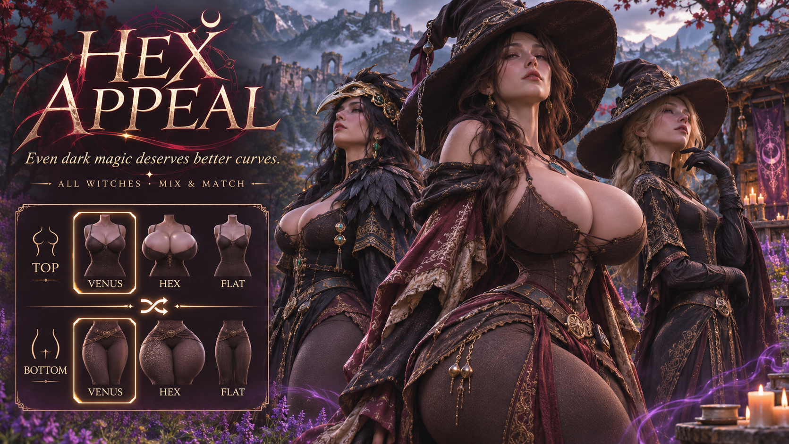

<b>VENUS. HEX. FLAT. Your questionable little blend of all three.</b>

  

I made **Hex Appeal** to bring the actual installed **VENUS Human Body or Elf Body** to Crimson Desert's human witches, with an in-game shape editor and a shared **Wardrobe** for compatible outfits. Pick a witch, mix the top and bottom, and carry on. Changes save and apply automatically.

**Release 1.0.0, refreshed 17 November 2026:** one player ZIP includes the runtime, body routing and default outfit refits. DMM uses one **Hex Appeal** entry on Mods plus its normal ASI switch. Human/Elf body support, feature compatibility checks and expanded generic SDK examples are included. See [verification](docs/VERIFICATION-1.0.0.md) for the tested scope.

**Development 0.5.9:** Weight is independent of the optional Dancer download. It remains usable without Sexy Witches installed; the published 1.0.0 package predates this change. See [Weight controls](docs/WEIGHT-CONTROLS.md).

**[Downloads](https://github.com/TAS-69/HexAppeal/releases) · [Install](docs/wiki/Installation.md) · [Player guide](docs/wiki/Home.md) · [Wardrobe SDK](docs/wiki/SDK-quick-start.md) · [Requirements & credits](DEPENDENCIES-AND-REFERENCES.md)**

## A little witchcraft

| Shape | Wardrobe | Make it yours |
| :--- | :--- | :--- |
| Independent HEX / VENUS / FLAT top and bottom, blended on one pad | Default outfit or separately installed Sexy Witches Dancer Dress | Six saved witch profiles and All witches |
| All nine combinations, with gentle sticky points | Five supplied Dancer colours, with automatic refresh | Independent Height and Weight |
| Compatible body and outfit pose deformation | Separate Base underwear section | F9, rescaling, input blocking and a pinnable quick panel |
| Included default-outfit refits | Open SDK for outfit names, variants, toggles and underwear linkage | Automatic saves and restoration after loading |

Supported human forms: **Lyselia, Bari, Areciel, Elowen, Sylvia and White Crow**, including the alternate Bari appearance. Bird/drone White Crow is outside this scope.

## Get started

1. Install one **VENUS Human Body or Elf Body** variant, **Hex's Hentai Preset**, **Instant Surgery** and a working x64 ASI loader separately.
2. Close the game and import **HexAppeal-1.0.0.zip** into **Desert Mod Manager**. For optional Dancer support, run the included setup from the installed folder before mounting. Enable Hex Appeal on Mods and its ASI switch, review conflicts and mount once.
3. Load a save near a witch and press **F9**. Check **Settings → Dependencies & paths** if something is unavailable.

The [installation guide](docs/wiki/Installation.md) covers each package, priorities and the optional Dancer setup. Python is only needed for the optional Dancer setup helper or building from source.

## In game

*Actual gameplay screenshot supplied with the project. The banner is promotional artwork.*

## Outfit creators welcome

Register an outfit's real name and the options it actually supports. Wardrobe handles the menu, saved choices, witch targeting and pins; your mod supplies its own assets. Use engine visibility parts, complete prefab variants or your own renderer. Start with the [beginner SDK guide](docs/wiki/SDK-quick-start.md), then use the [advanced examples](docs/wiki/SDK-examples.md) for complete colour/toggle matrices, provider lifecycle, effective visibility, rebuilt instances and refresh/error handling.

## A few things to know

Dancer colours are **global**. Its embedded bra/top has no independent removal option. Base underwear does not remove arbitrary geometry from other outfits. Minor hand/skirt and extreme shoulder clipping remain. Intermittent pale Dancer blotches were absent in the last clean sample, but their cause is unresolved. See [compatibility and tested limits](docs/wiki/Compatibility.md).

**Validation:** 23 runtime checks, 29 SDK cases within that suite, 34 helper tests and 47 body/refit checks. All four SDK example targets compile. See the [verification scope](docs/VERIFICATION-1.0.0.md) for the exact release binary, results and live-test limits.

Downloaded bodies, presets, plugins and outfit files are **external dependencies**. They are not included here. My code and SDK are **0BSD**; compiled overlay/library adaptations retain their own notices. Game-derived default garment refits remain Pearl Abyss content. Thanks to **Kasprutz, Hex0x0, AlexeySova, Vincent1681**, and everyone credited in [dependency use & credits](DEPENDENCIES-AND-REFERENCES.md).
