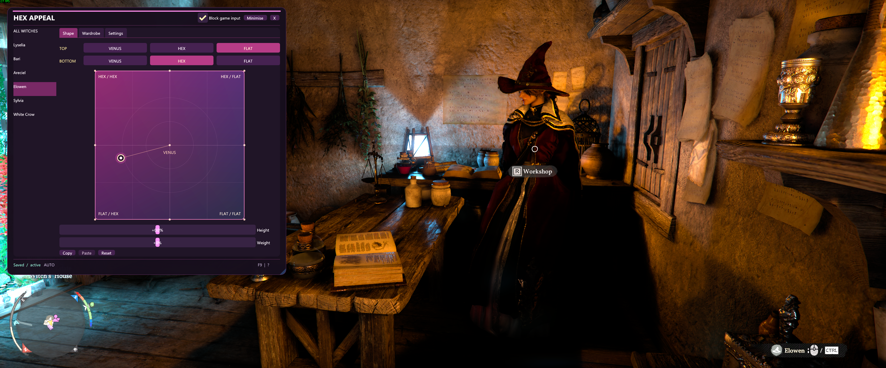

# Hex Appeal

**Choose a witch. Shape the body. Pick an outfit.**

Start with [Installation](Installation.md), then open the game panel with **F9**. You do not need the SDK to use Hex Appeal.

| I want to… | Read this |
| --- | --- |
| Install or remove the mod | [Installation](Installation.md) |
| Mix shapes and change proportions | [Shape controls](Shape-controls.md) |
| Change outfits, colours or underwear | [Wardrobe](Wardrobe.md) |
| Change the key, input capture, pins or paths | [Settings](Settings-and-paths.md) |
| Check conflicts or a problem | [Compatibility](Compatibility.md) |
| Add my own outfit | [SDK quick start](SDK-quick-start.md) |
| Author removable parts or alternate models | [SDK asset patches](SDK-asset-patches.md) |
| Look up the API | [SDK reference](SDK-reference.md) |
| Build or package the source | [Building](Building.md) |
| Check dependencies and how they are used | [Credits](Credits.md) |
| Understand release numbering | [Versioning](Versioning.md) |

