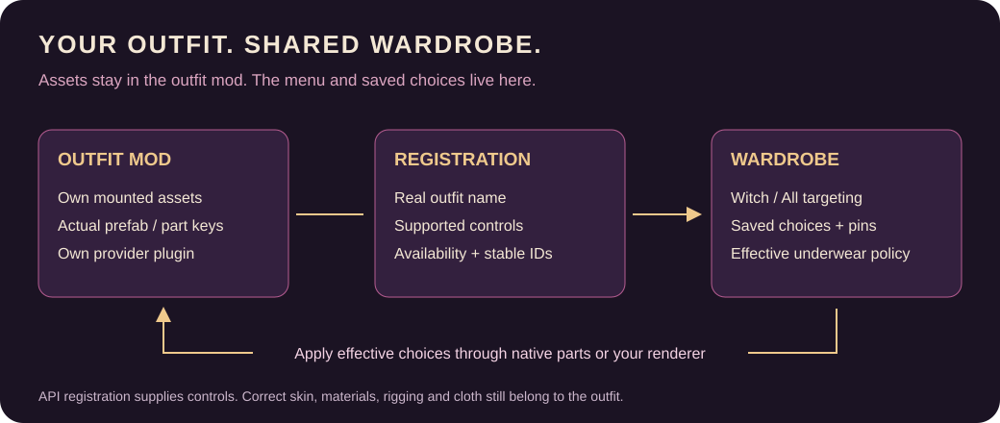

# Wardrobe SDK: start here

Your outfit stays in **your mod**. A small provider plugin tells Wardrobe its real name, options and resource readiness. Hex Appeal supplies the menu, saved choices, witch targeting and quick-panel pins. No outfit files are copied into Hex Appeal.



## Pick a route

| Your outfit supports… | Start with |
| --- | --- |
| Separate engine visibility parts | `parts-outfit.json` and `PartsOutfitProvider.cpp` |
| Complete alternative prefabs for combinations | `outfit.json` and `NativeOutfitProvider.cpp` |
| Your own renderer/material logic | `WardrobeProvider.cpp` |

The SDK download includes these files under `examples/`. In the repository they live in `runtime/sdk/examples/`.

You need an x64 Windows C++17 provider plugin. The examples compile as objects for your plugin; they are not standalone ASIs. A file-only outfit can still be installed normally, but adding it to this menu needs provider code. JSON is a build definition, not an auto-loaded outfit manifest.

For a character add-on, use a TSV manifest and the SDK packager. See the [character add-on format](../../runtime/sdk/CHARACTER-ADDONS.md) and the [Rucchia and Stranger example](../../runtime/sdk/examples/character-variants/README.md).

## First integration

1. Copy the SDK into your provider project. Use a stable ID such as `yourname/dress` and the actual outfit/mod title as its label. The `hexappeal/` namespace is reserved.
2. Replace example prefab/part names with **real installed names**. Remove unsupported controls. Keep assets in your own DMM package.
3. Generate the registration header:

```powershell
python runtime/sdk/tools/generate_provider.py runtime/sdk/examples/parts-outfit.json --output build/PartsDefinition.hpp
```

4. Include that header and the C++ helper. Change the example's generated registration function to match your ID. Call its `Update(mountedAssetsReady)` from your ordinary update after loader initialization. Retry until Hex Appeal is ready.
5. Mark available only when your actual resources are mounted and usable. Unregister through `Shutdown()` before your provider unloads. Never call into Hex Appeal from `DllMain`.
6. Test your own assets in game. [The patch checklist](SDK-asset-patches.md) covers what registration alone cannot verify.

Unknown readable dependency releases should warn without blocking usage. Missing or unreadable resources disable the affected option. An actual incompatible native operation must still report an error.

Continue with [asset patches](SDK-asset-patches.md), [examples](SDK-examples.md) or the [API reference](SDK-reference.md). Full SDK documentation is in the source/download README.
