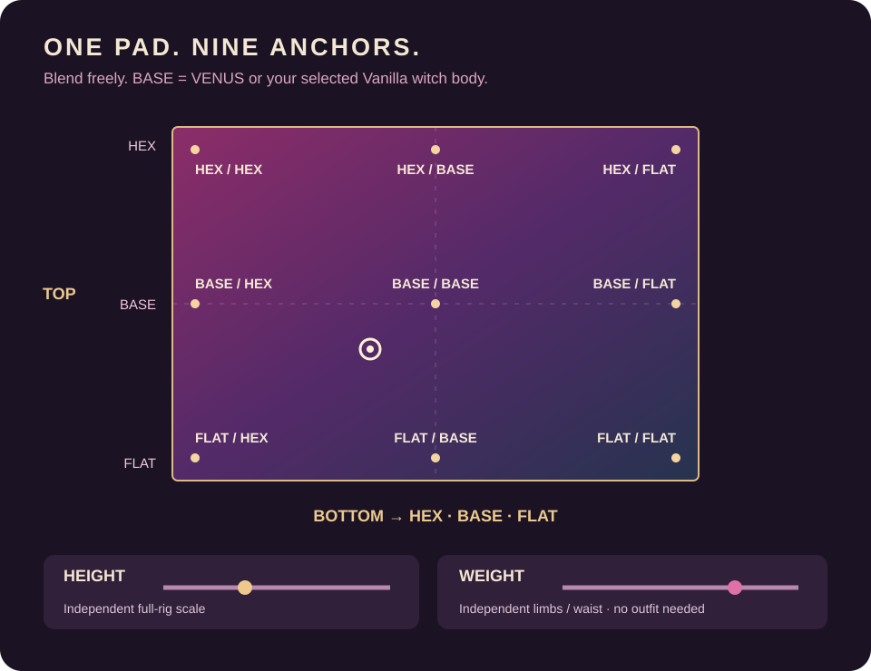

# Shape controls

Select one witch or **All witches**. Changes save automatically and apply when the matching witch is available. No Apply button is needed.

## The pad

**Vertical = Top. Horizontal = Bottom.** Each axis runs HEX → baseline → FLAT. The centre is VENUS/VENUS or VANILLA/VANILLA, depending on your body option. The upper-left is HEX/HEX; the lower-right is FLAT/FLAT. Every original combination is still present, with continuous blends between them.

The nine marked points have gentle detents: snap within two pixels, release beyond three. The Top and Bottom buttons move only their own axis to an exact preset; the other region keeps its current blend.

VENUS uses the installed Venus Body for Damiane (Human or Elf Body) with neutral native deformation. Vanilla preserves each witch's original body and proportions at the centre, with Height and Weight zero. HEX reads Hex's Hentai Preset, including its stomach/waist parameters. Discovery prefers a matching body preset where available. FLAT uses the native minimum for the selected breast/butt size region; it does not scale a body part to zero. Other regional parameters blend through the same native shaping route.

## Height and Weight

Both are separate from the pad and from each other. **Shortest height with maximum Weight is valid.** Height scales the full rig proportionally by up to ±10%. Weight adjusts waist and limbs, while keeping the selected breast/butt shaping parameters. Weight uses the native shaping adapter directly and needs no outfit dependency. It is a native approximation informed by an earlier visual body reference, not a live mesh refit or an exact recreation. Dancer integration is excluded from this package. See [Weight controls](../WEIGHT-CONTROLS.md).

## Profiles and status

Each of the six witches has a profile. **Copy / Paste** transfers shape and proportions. **Reset** returns to the selected baseline with neutral proportions. All witches applies the edit to every profile; mixed choices can be shown when profiles differ.

**Saved / active** means the native body/outfit upload was acknowledged. **Saved / waiting** means the choice is stored and waiting for its witch, dependency or upload. Rapid edits are combined so the final choice is retained. Saved shapes restore when supported actors load, including after a restart.

Compatible clothing follows the coordinated pose deformation. The separate default-outfit refits are a static fit to Venus Body for Damiane. This does not regenerate arbitrary cloth meshes or guarantee a perfect fit for every outfit.
